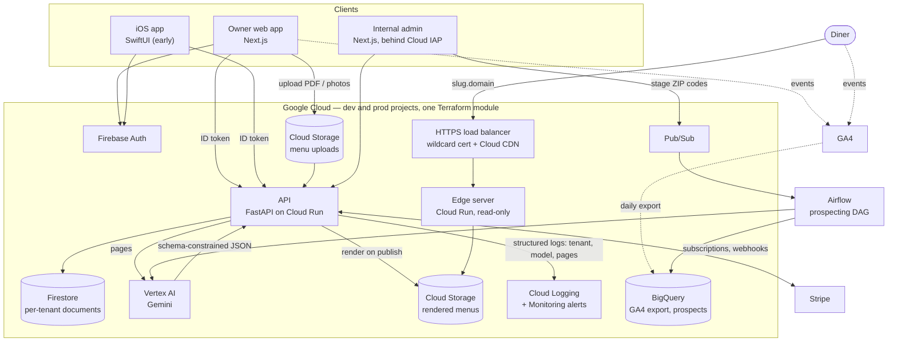

# 1prairie.menu — architecture and engineering

[1prairie.menu](https://1prairie.menu) is a multi-tenant SaaS for independent restaurants. An owner uploads a PDF or photos of their menu, and Gemini turns them into a structured, editable menu. The owner then publishes it as a fast, SEO-friendly page on the restaurant's own subdomain. The product is live, with real Stripe subscription billing. It runs on Google Cloud: Next.js and FastAPI on Cloud Run, Firestore, Vertex AI, BigQuery, an Airflow pipeline, and Terraform. I designed and built all of it, and I operate it alone.

This repository is a public window into that work. The product's source is private. What's here is the architecture, three of the project's decision records, and three sanitized code samples.

## Architecture



**Ingestion, from document to draft.**
1. The owner uploads pages to Cloud Storage under a per-user path.
2. The API checks that the caller owns the restaurant and the files. It enforces size, type and rate limits, and increments the tenant's AI usage counter.
3. It sends every page to Gemini in one call, with the response constrained to a JSON schema, then validates the result with Pydantic.
4. The result becomes a pending draft. Accepting the draft writes the whole menu in one atomic Firestore batch.

See [`samples/gemini-ingestion`](samples/gemini-ingestion/).

**Publishing to a subdomain.**
- Publishing renders the menu to static HTML in Cloud Storage.
- A global HTTPS load balancer with a Certificate Manager wildcard certificate and Cloud CDN routes every `<slug>.<menu-domain>` to a small read-only Cloud Run service.
- That service maps the `Host` header to an object and serves it with ETags. It holds no secrets and never touches the database.
- A republish is live on the next revalidation, with no CDN invalidation call.

**Multi-tenancy.**
- Each restaurant is a Firestore document tree.
- Firestore and Storage security rules decide what clients may read and write.
- Writes that must be authoritative go through the API: creating a tenant, claiming a slug, accepting a draft, publishing, deleting an account. The API re-checks ownership and logs any cross-tenant attempt under a key that pages on the first hit.

**Analytics and AI cost tracking.**
- GA4 covers the owner app and public pages, with consent mode on public surfaces. A native daily export puts raw events in BigQuery for SQL-level funnel and cohort analysis.
- AI usage is tracked per tenant two ways: a Firestore counter, and one structured log line per model call (tenant, model, page count, outcome). Those fields are designed to join with the GCP billing export for per-tenant cost.
- The prospecting pipeline logs an estimated model cost on every run.

**Prospecting pipeline.** An Airflow 3 DAG finds independent restaurants by ZIP code, deduplicates them across sources, loads them into BigQuery with idempotent MERGEs, and enriches them with Gemini. Work arrives from a manual trigger or from Pub/Sub messages published by the internal admin app. See [`samples/airflow-dag`](samples/airflow-dag/).

More detail on the data model, tenancy and cost tracking: [`docs/architecture.md`](docs/architecture.md).

## Stack

| Layer | Technology |
|---|---|
| Owner web app, internal admin | Next.js, React, TypeScript, Tailwind |
| API, edge server | Python 3.12, FastAPI, Pydantic, on Cloud Run |
| iOS | Swift, SwiftUI (early stage) |
| Data | Firestore, Cloud Storage, BigQuery |
| AI | Vertex AI: Gemini, structured output |
| Pipelines | Apache Airflow 3 (TaskFlow), Pub/Sub, BigQuery |
| Auth | Firebase Auth (customers), Cloud IAP with Workspace identity (internal tools) |
| Billing, email | Stripe subscriptions and webhooks, a transactional email API |
| Delivery | Global HTTPS load balancer, Certificate Manager wildcard cert, Cloud CDN |
| Infrastructure | Terraform (one module, dev and prod), Cloud Build, Artifact Registry, Secret Manager |
| Observability | Cloud Logging, log-based metrics, Cloud Monitoring alert policies and uptime checks, budgets |
| Analytics | GA4 with consent mode, GA4 → BigQuery export |
| Marketing site | Astro on Firebase Hosting |
| Monorepo | pnpm workspaces, Turborepo, uv |

## Engineering practices

- **Infrastructure as code.**
  - One Terraform module defines a product's GCP project. Dev and prod are two instances of it: dev was imported into Terraform, and prod was built from the same module.
  - Terraform owns APIs, IAM and least-privilege service accounts, Cloud Build triggers, Firestore (point-in-time recovery and `prevent_destroy` in prod), Secret Manager containers, the serving stack, budgets and alerting.
  - It deliberately does not own Cloud Run revisions, secret values or security rules, and [ADR-0012](docs/adr/0012-terraform-for-infra.md) explains why.
- **Delivery.**
  - Cloud Build triggers deploy each service: the integration branch deploys to dev, and a promotion to the main branch (or a release tag) deploys to prod.
  - GitHub Actions run the iOS build, lint and test lane on macOS runners, an ADR index check, a guard on pull request target branches, and automated code review.
  - Branch protection is set with repository rulesets.
- **Testing.**
  - About 1,060 test cases: pytest for the API and pipeline, Vitest for the web apps, and 42 Firestore security-rules tests against the emulator.
  - Playwright end-to-end tests run against the Firebase emulators.
  - Smoke tests run against the deployed environments. One of them does a real sign-up and a real Vertex AI extraction for about a cent.
  - The unit, rules and end-to-end suites run before merge through `make test` and Turborepo, rather than in a hosted CI job. Each pull request records what ran in its test plan.
  - Log keys that alerts depend on are pinned by unit tests.
- **Decision records.** 23 ADRs, each written when the decision was made, with alternatives and consequences. Superseded decisions stay in the log. A small tool assigns numbers at merge time, so parallel branches don't collide, and CI checks the index. Three are in [`docs/adr`](docs/adr/).
- **Runbooks.** Nine runbooks, for project bring-up, the serving stack, IAP, Cloud Build triggers, alerts, email and notifications. Each alert links to its own runbook section.
- **Secrets.**
  - No API keys in code.
  - Google services, Vertex AI included, are reached with Application Default Credentials and per-service runtime service accounts.
  - Third-party credentials live in Secret Manager and are mounted into Cloud Run at deploy time. Terraform creates the secret containers but never sees the values.
  - Internal tools sit behind Cloud IAP, on a separate sign-in from customer accounts, with no new credentials.
- **Security in depth.**
  - Firestore and Storage rules are tested.
  - The API re-checks ownership on every write that could cross tenants, and checks client-written ids for path injection.
  - Cross-tenant attempts alert on the first hit.
- **Monitoring.**
  - Uptime checks from several regions.
  - Alerts on 5xx ratio, p99 latency (public services only), instance count, a Firestore read-rate cost canary, and application alerts from structured log keys.
  - Per-project budgets with alerts.
  - See [`samples/terraform-monitoring`](samples/terraform-monitoring/).

## By the numbers

Computed from the private monorepo's main branch on 2026-11-17. The commands are below.

| | |
|---|---|
| Lines of code (excluding blanks, comments, lockfiles) | 47,363 across 521 files |
| TypeScript | 18,430 |
| Python | 14,151 |
| Terraform (HCL) | 1,444 |
| Astro | 1,334 |
| Shell | 674 |
| Firebase security rules | 290 |
| Swift | 204 |
| Markdown documentation | 8,218 |
| Commits on main | 797, from 2026-04-24 to 2026-10-20 |
| Merged pull requests | 212 |
| Test cases | 1,060 (634 Python, 377 TypeScript, 42 Firestore rules, 7 Swift) |
| Architecture decision records | 23 |
| Runbooks | 9 |
| CI/CD definitions | 5 GitHub Actions workflows, 5 Cloud Build pipelines |
| Terraform environments | 2 (dev, prod) from one module |

<details>
<summary>How these were computed</summary>

Run in a checkout of the monorepo after `git fetch`. Test counts are static: they count test functions and `test(` / `it(` calls, and don't expand parametrized cases. cloc reports the two `.rules` files as "Snakemake"; they are Firebase security rules.

```bash
# Lines of code by language, at origin/main, lockfiles excluded
cloc --git origin/main --quiet --not-match-f='(pnpm-lock\.yaml|uv\.lock|package-lock\.json)$'

# Commits and date range
git rev-list --count origin/main
git log --reverse --format=%ad --date=short origin/main | head -1
git log -1 --format=%ad --date=short origin/main

# Merged pull requests (merge commits on main)
git rev-list --count --merges origin/main

# Python test functions
git grep -E '^[[:space:]]*(async )?def test_' origin/main -- '*.py' | wc -l

# TypeScript test cases (Vitest, Playwright, rules tests)
git grep -E '^[[:space:]]*(test|it)(\.(only|skip|each[^(]*\([^)]*\)))?\(' origin/main -- \
  '*.test.ts' '*.test.tsx' '*.spec.ts' '*.spec.tsx' '*.test.js' '*.test.mjs' '*.test.mts' | wc -l

# Firestore security-rules tests (a subset of the TypeScript count)
git grep -E '^[[:space:]]*(test|it)\(' origin/main -- tests/firestore-rules/firestore-rules.test.ts | wc -l

# Swift tests
git grep -E '@Test|func test' origin/main -- '*.swift' | wc -l

# ADRs, runbooks, workflows, Cloud Build pipelines, Terraform environments
git ls-tree -r --name-only origin/main | grep -cE '^docs/decisions/[0-9]{4}-.*\.md$'
git ls-tree -r --name-only origin/main | grep -cE '^docs/runbooks/.*\.md$'
git ls-tree -r --name-only origin/main | grep -cE '^\.github/workflows/.*\.ya?ml$'
git ls-tree -r --name-only origin/main | grep -cE 'cloudbuild.*\.ya?ml$'
git ls-tree -r --name-only origin/main | grep -E '^infra/terraform/envs/' | cut -d/ -f4 | sort -u
```

</details>

## What's in this repo

| Path | Contents |
|---|---|
| [`docs/architecture.md`](docs/architecture.md) | Data model, tenancy and authorization, publishing, AI cost tracking. |
| [`docs/adr/`](docs/adr/) | Three ADRs: Vertex AI as the AI provider (0005), slug uniqueness as a security invariant (0010), Terraform and its boundaries (0012). |
| [`samples/gemini-ingestion/`](samples/gemini-ingestion/) | Document to structured menu with Gemini: schema-constrained output, retries, tenant isolation, per-tenant usage. |
| [`samples/airflow-dag/`](samples/airflow-dag/) | The prospecting DAG: a BigQuery work queue, Pub/Sub intake, idempotent loads, guardrails, LLM enrichment. |
| [`samples/terraform-monitoring/`](samples/terraform-monitoring/) | Cloud Run, Firestore and Vertex AI alerting as code. |

The samples are adapted from production code. Identifiers are replaced with placeholders, and internal helpers are replaced with clearly named stubs. They are syntactically valid (`py_compile`, `terraform validate`) but aren't packaged to run.

The full codebase is private. I'm happy to walk through it on a call; you can reach me through [9poundhammer.com](https://9poundhammer.com).

---

Copyright 2026 Nine Pound Hammer LLC. All rights reserved; see [LICENSE](LICENSE).
